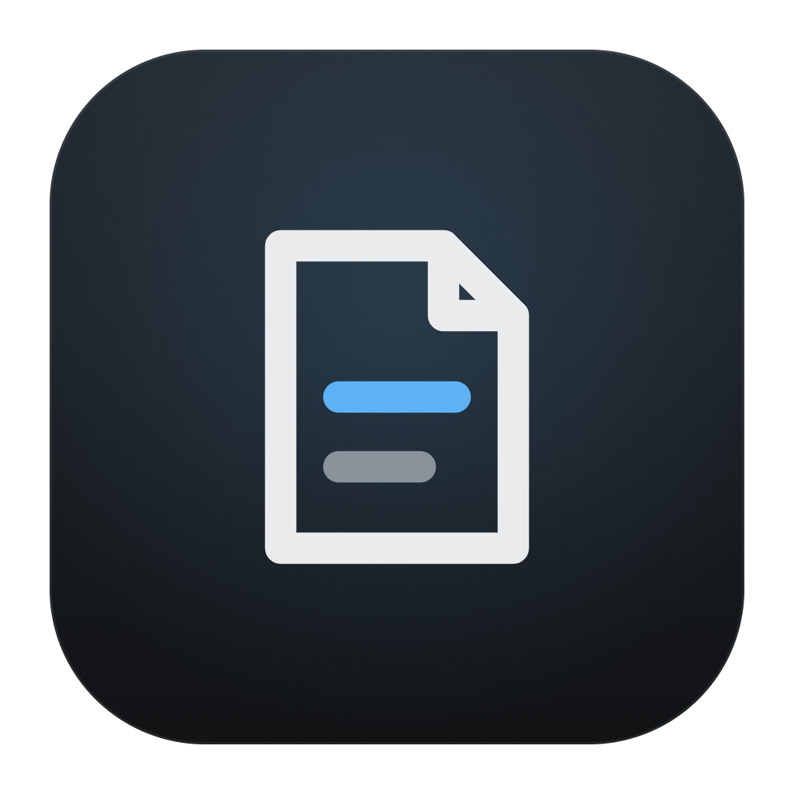
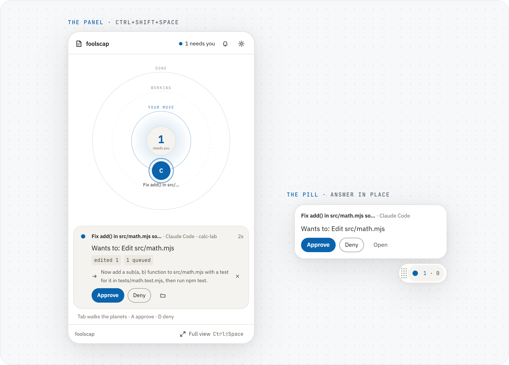
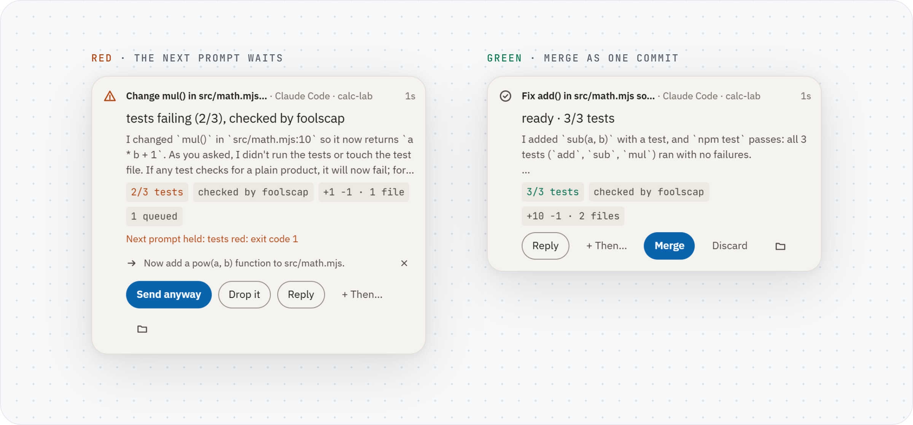
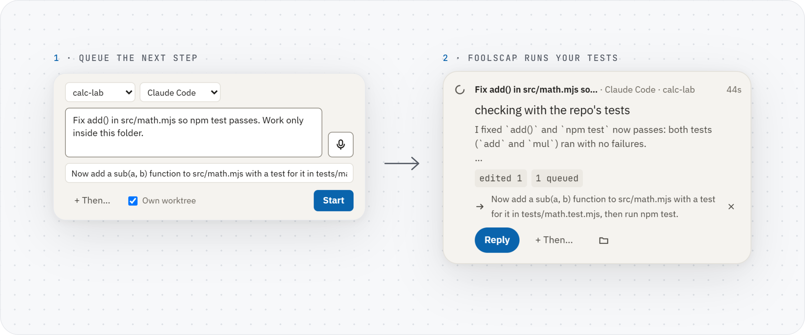

<p align="center">
  
</p>

<h1 align="center">foolscap</h1>

<p align="center">
  <b>The inbox for your coding agents.</b><br>
  Know the moment an agent needs you. The next prompt waits for green tests.
</p>

<p align="center">
  <a href="https://github.com/N-45div/foolscap/actions/workflows/ci.yml"></a>
  <a href="https://github.com/N-45div/foolscap/releases"></a>
  
  <a href="LICENSE"></a>
</p>

<p align="center">
  <a href="https://foolscap.dev"><b>Website</b></a> ·
  <a href="#install"><b>Install</b></a> ·
  <a href="#how-the-queue-decides"><b>How the gate works</b></a> ·
  <a href="CONTRIBUTING.md"><b>Contributing</b></a>
</p>

<br>

<picture>
  <source media="(prefers-color-scheme: dark)" srcset="docs/screenshots/hero-dark.png">
  
</picture>

<p align="center"><sub>Every screenshot here is foolscap's real UI, replaying two real Claude Code runs from 18 Oct 2026.</sub></p>

## Why

Running three agents at once fails the same way every time. You keep
switching terminals to see which one is stuck on a permission prompt,
which one finished, and which one broke the tests.

foolscap does that watching for you. It sits in your tray, tells you
the moment an agent needs you, lets you answer right there, and sends
the next prompt only when the repo's own tests pass.

## Features

- **One glance.** A small pill floats above the taskbar with what needs
  you. Click the tray icon or press `Ctrl+Shift+Space` for the panel:
  **Your move** at the centre (approvals, failing checks, finished
  work), **Working** around it, and a line to start the next task.
- **Answer in place.** When an agent asks to edit a file or run a
  command, hover the pill or open the notification: **Approve**,
  **Deny**, or type a reply, without switching windows.
- **Queue the next step.** Give a task its "then…" steps. After every
  turn foolscap runs the repo's tests itself, outside the agent's
  sandbox, and sends the next prompt only on green. Red or unclear holds
  the queue and tells you why. You can always send anyway.
- **Green means green.** A run passes only with exit code 0 and at least
  one test that actually ran, read from the runner's own counts. Zero
  tests, a missing exit code or a sandbox block is never green.
- **Many agents, one repo.** Every task gets its own git worktree, so
  several agents can work on the same repo at once. When one is done and
  green: **Merge** (one commit on your branch) or **Discard**.
- **Side by side.** Open any task in VS Code, Cursor, Windsurf,
  Antigravity or Zed. Every task gets its own ports, and **Run** starts
  its dev server, so you can try two tasks' work at the same time.
- **Every agent in one place.** Claude Code and Codex natively, plus any
  agent that speaks [ACP](https://agentclientprotocol.com). Sessions
  you start yourself in a terminal can show up too, approvals included.
- **While you were away.** Come back and the panel says what happened:
  what finished green, what went red, what went out from the queue, what
  is waiting for you. Counted from a local journal, never guessed.
- **Voice prompts.** Click the mic, say what to do, and a clean prompt
  lands in the box.

### The gate

<picture>
  <source media="(prefers-color-scheme: dark)" srcset="docs/screenshots/gate-dark.png">
  
</picture>

The run on the left was broken on purpose to show the gate: the agent was
told to change `mul()` and not to run the tests. foolscap ran them anyway,
saw 2 of 3 pass, and held the next prompt. On the right, a task that came
back 3/3 green and is one click from a single commit.

### The queue

<picture>
  <source media="(prefers-color-scheme: dark)" srcset="docs/screenshots/queue-dark.png">
  
</picture>

## Agents

| Agent | How foolscap runs it | Approvals in foolscap |
|---|---|---|
| **Claude Code** | your own `claude`, natively (stream-json) | yes, through a permission relay |
| **Codex** | your own `codex exec --json`, one run per turn | no: headless Codex works inside its sandbox |
| OpenCode, Goose, Qwen Code, Kimi CLI, GitHub Copilot CLI, Kiro | ACP over stdio | yes, ACP permission requests |
| **Hermes**, **OpenClaw** (assistants) | `hermes acp`, `openclaw acp` | yes; their queue always waits for you |
| Claude Code / Codex through their ACP adapters | `npx` adapters, pinned | yes; API keys only (see below) |
| Anything else that speaks ACP | give its command | yes |

foolscap only lists agents it finds installed. On Windows it looks
through npm `.cmd` shims and native installers to the real executable,
and launches it with no shell in between.

## Install

Download from **[foolscap.dev](https://foolscap.dev)** or the
**[Releases](https://github.com/N-45div/foolscap/releases)** page. 1.0 is
in beta.

**Windows 10 and 11:** run `foolscap-setup-x64.exe`. The installer is
not code-signed yet, so SmartScreen may say "Windows protected your PC":
choose **More info › Run anyway**. On Windows 11, new tray icons start
behind the `^` arrow: switch foolscap on under **Settings ›
Personalization › Taskbar › Other system tray icons** to keep it in
sight.

**Linux (x64):**

```sh
sudo apt install ./foolscap-amd64.deb          # Debian, Ubuntu
sudo dnf install ./foolscap-x86_64.rpm         # Fedora, RHEL
sudo pacman -U ./foolscap-x64.pacman           # Arch
chmod +x foolscap-x86_64.AppImage && ./foolscap-x86_64.AppImage   # anywhere
```

On GNOME, tray icons need the
[AppIndicator extension](https://extensions.gnome.org/extension/615/appindicator-support/).
`Ctrl+Shift+Space` and the pill work everywhere.

foolscap runs the agents you already have, so install and sign in to at
least one of them first (for example `claude` or `codex`).

### Build from source

```sh
git clone https://github.com/N-45div/foolscap.git
cd foolscap
pnpm install
pnpm dev          # runs the tray app from source
pnpm dist:win     # or dist:linux: installers into release/
```

Needs Node 22.5+ and pnpm.

## How the queue decides

After a turn, foolscap finds the repo's test command:

1. `.foolscap.json` with `{ "test": "…" }`, if the repo has one;
2. else the `package.json` test script, run by the package manager its
   lockfile names (npm, pnpm, yarn or bun);
3. else `cargo test`, `go test ./...` or `python -m pytest -q`.

It runs that command outside any agent sandbox (on Windows, Codex's
sandbox stops `node --test` before any test code runs) and reads the
result strictly. Green sends the next queued prompt. Red, unclear, an
error or a stopped turn holds the queue with the reason. An assistant's
queue always waits for you.

## Worktrees

New tasks get a worktree under your local app data folder by default
(untick **Own worktree** to work in the folder directly). Installed
dependencies (`node_modules`, `.venv`) are linked in from your checkout,
and files listed in a `.worktreeinclude` at the repo root (one per line,
like `.env.local`) are copied. **Merge** refuses if your checkout has
uncommitted changes and backs out of a conflict, so your own work is
never mixed in.

## Side by side

**Open** on a task lists the editors installed on your computer (VS Code,
Cursor, Windsurf, Antigravity, Zed) and opens that task's folder in a
window of its own, so three tasks can mean three editor windows. foolscap
runs each editor's own launcher, with no shell in between.

**Ports.** Every task foolscap starts gets its own block of ten ports,
from 4100 up (4100–4109, 4110–4119, …), skipping any port something is
already listening on. The agent gets `PORT` (the first port) and
`FOOLSCAP_PORTS` (`4110-4119`), so two agents starting dev servers never
fight over 3000.

**Run** starts the task's dev server in its folder on its `PORT`. The
command comes from `.foolscap.json`, else the `dev` or `start` script in
`package.json`, run by the package manager the lockfile names. `$PORT` in
the command becomes the number, for servers that don't read `PORT`
themselves:

```json
{ "test": "pnpm test", "run": "pnpm dev --port $PORT" }
```

The card shows the address the server prints (or `localhost:PORT` once
it answers) as a link, and **Stop** ends the server and everything it
started. Merge and Discard stop it first. On Windows, a task folder still
open in an editor when you merge or discard is removed once you close
that window.

## Sessions you start yourself

Settings › **Claude Code sessions from my terminal** shows the exact
hooks foolscap would add to your Claude Code settings before it adds
them, backs the file up first, and **Turn off** removes exactly those.
The hooks post to `127.0.0.1:47821` with a secret token. If foolscap is
closed, Claude Code carries on as normal; a permission you don't answer
in foolscap within 45 seconds is asked in your terminal as usual. A
queued prompt goes out when the session next stops, after the repo's
tests pass.

## Your login stays yours

foolscap runs the agent CLIs you already installed and signed in to,
unmodified. It never reads, stores or forwards your tokens. It removes
`ANTHROPIC_API_KEY`, `OPENAI_API_KEY` and `CODEX_API_KEY` from the agents
it launches, so a key left in your environment can't silently move your
subscription to pay-per-token billing. The Claude Code and Codex ACP
adapters authenticate through SDKs whose terms do not cover routing a
personal subscription through another app, so they are listed for API
keys only.

By default Claude Code starts with your own settings and `CLAUDE.md`.
Turn off **Use my Claude Code settings** to start it with only the
repo's settings.

## Voice prompts

Click the mic in the new-task line, talk (Hinglish works too), click
again, and a clean prompt lands in the box. The audio is cut at your
pauses and sent while you talk, so the prompt is ready moments after you
stop. It goes to foolscap Cloud with your licence key and nothing else;
it is transcribed and written up there, and neither the audio nor the
text is kept.

## Official builds

The code is free: read it, change it, build it yourself. The official
installers are how foolscap is paid for. They start with a 14-day free
trial, then take a one-time licence from
[foolscap.dev](https://foolscap.dev/#pricing), which comes with a weekly
allowance of voice prompts. A build you make yourself never asks for
one.

When an official build checks a licence, only the key, its activation
and your computer's name are sent, and a key keeps working offline for 7
days after its last check.

## Develop

```sh
pnpm test         # node --test: no network, no API keys, no real agents
pnpm build        # the renderer into dist/renderer
```

- `app/main/`: the Electron main process (tray, pill, panel,
  notifications, permission relay, settings)
- `app/renderer/`: the panel, pill and full window (React)
- `server/`: the session core: drivers, the next-prompt queue, evidence,
  test verification, worktrees

See [CONTRIBUTING.md](CONTRIBUTING.md) for adding an agent or a driver,
and [CHANGELOG.md](CHANGELOG.md) for what changed in each release.

## License

[GPL-3.0-or-later](LICENSE): you may use, change and share foolscap, and
any copy you share must stay open under the same licence.

<sub>The name: foolscap is the paper ledgers were written on.</sub>
